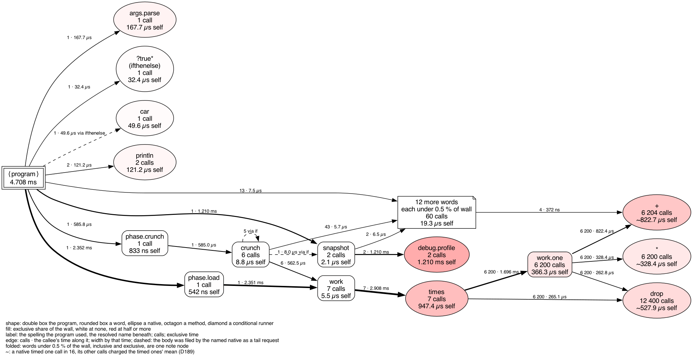

# profiler_demo

Every feature of `debug.profile`, the word that writes the profile of the
run so far. `--profile <base>` writes a report when the program ends;
`"<base>" debug.profile` writes one at any moment the program chooses, and
the run goes on. The word is Bund2's own, not the reference's (D190).

    make                 # four reports in profiles/
    make graphs          # and an .svg of each (needs Graphviz)

or, without `make`, from this directory:

    mkdir -p profiles
    bund2 script --profile profiles/end --file demo.bund -- --out profiles

`demo.bund` runs four phases and writes a snapshot during three of them:

| file in `profiles/` | written | what it shows |
|---|---|---|
| `1-after-load` | at the top level, after phase 1 | 2 calls still open: `snapshot` and the `debug.profile` inside it |
| `2-deep-in-crunch` | from the bottom of a recursion six calls deep | 9 calls open, each counted up to that moment |
| `3-progress` | four times, once after each round of a loop | the last write wins: the run up to the end of the fourth round |
| `end` | by `--profile`, when the program ends | the whole run, `debug.profile`'s own calls included |

A fourth snapshot, aimed at `/no/such/directory/x`, fails and is caught.

## What each feature is

**A snapshot of the record, not the end of it.** The word copies the
profile, closes the copy's open calls at that moment, and writes the
copy with the same two renderers `--profile` uses: a markdown report and
a Graphviz `.dot` graph. The record itself goes on, and the `end` report
is the whole run. The header's `ended` cell says the run had not ended
and how many calls were open:

    not yet: written mid-run by `debug.profile`, 9 activations still open and counted to that moment

The bodies of `if` and `times`, which no word names, are not counted.
An open call's time runs up to the snapshot, so `phase.crunch` reads
about 0.6 ms in `2-deep-in-crunch` and about 1.3 ms in `end`, which
includes the snapshot it was waiting on.

**The program chooses the path.** One STRING operand, the base: the word
writes `<base>.profile.md` and `<base>.profile.dot`. `demo.bund` builds it
from `--out <dir>`, so one program can write as many snapshots as it
likes.

**One base, written again, stays current.** Phase 3 writes `3-progress`
after each of four rounds. A long-running program can keep one report up
to date this way: read the file at any moment and it is as old as the
last write. Each file is written beside its target first and then moved
into place, so a reader never sees half a report.

**Writing costs time, and the report shows it.** Each snapshot renders
two files while the program waits. That time belongs to `debug.profile`
in the next report. In a run this small it tops the hottest-words table,
at about a millisecond per snapshot, so snapshot a hot loop sparingly.

**Estimated figures are marked here too.** `+`, `*` and `drop` cost less
than the clock that would time them, so after their first 64 calls each is
timed one call in 16 and the rest are charged the average (D189). Their
times carry a `~` in every snapshot, and each report's *Timing* section
lists them. Call counts and steps are exact in every report.

**A write that fails is an error the program can catch.** Phase 4 wraps
the word in `?try`:

    a snapshot could not be written: Lambda content evaluation returned error: DEBUG.PROFILE: writing /no/such/directory/x.profile.dot: No such file or directory (os error 2). No profile was written.

**No profile is a warning, not an error.** A program instrumented with
`debug.profile` still runs without `--profile`. The first snapshot prints
one warning on stderr, the rest are skipped without one, nothing is
written, and the program goes on:

    make unprofiled
    Warning: DEBUG.PROFILE: this run keeps no profile, so nothing was written; run it with `--profile <base>`. Said once: later snapshots in this run are skipped without a warning

Phase 4 prints nothing then: with nothing to write, nothing failed.

**A bundle always warns.** `make bundle` builds `./profiler_demo` with
`bund2 build`. A bundle takes no `--profile`, so it keeps no profile and
prints the warning above once. Profile from source.

**`--noio` turns it off.** The word writes files, so under `--noio` it is a
stub that fails, like every other word that touches the host's files. The
run stops at the first snapshot:

    make noio
    │ Error    ┆ bund DEBUG.PROFILE functions disabled with --noio │

## The graph

`deep-in-crunch.profile.png` is `2-deep-in-crunch.profile.dot` drawn with
`dot -Tpng`. Nodes and edges are as in the `end` graph, cut off at the
moment of the snapshot.

## Writing Bund like this

Two things in `demo.bund` catch people out:

- `times` pushes the round's index before each run of its body, so a
  body that should leave the stack as it found it starts with `drop`.
- Bund's binary words take their right operand first: `a b +` is `b + a`,
  and `n 0 <` asks `0 < n`. `demo.base` builds `<dir>/<name>` with two
  `+`s for that reason.
